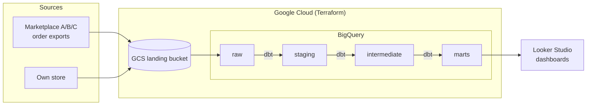
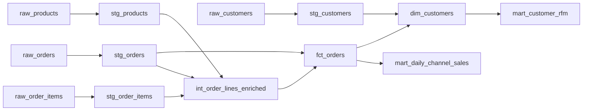

# ec-analytics-platform

[](https://github.com/yahayuta/ec-analytics-platform/actions/workflows/ci.yml)

A reference analytics platform for a multi-channel e-commerce business, built with
**dbt**, **BigQuery** and **Terraform**. Every model is tested in CI on DuckDB, so you
can clone it and run the whole pipeline locally in under a minute, with no cloud account.

All data is synthetic and generated by a script in this repository.

## The problem it solves

A shop that sells on several marketplaces and its own site usually ends up with:

- order exports that differ per channel and contain duplicates and messy keys,
- revenue numbers that do not match between teams,
- dashboards built straight on raw data, which break whenever a source changes.

This project shows one way to fix that: land the raw data, clean it once in a tested
staging layer, put the business rules in one place, and give BI tools a small set of
trusted tables.

## Architecture



| Layer | Materialization | What happens there |
|---|---|---|
| `raw` | seed / load job | Data exactly as received |
| `staging` | view | Deduplicate, cast types, normalize keys (one model per source) |
| `intermediate` | view | Reusable joins and margin calculation |
| `marts` | table | Facts, dimensions and KPI tables for BI |

## Models



| Model | Grain | Use |
|---|---|---|
| `fct_orders` | order | Revenue, margin and status per order |
| `dim_customers` | customer | Lifetime revenue, first/last order, repeat flag |
| `mart_daily_channel_sales` | day × channel | Orders, cancellations, revenue, margin, AOV |
| `mart_customer_rfm` | customer | Recency / Frequency / Monetary scores and CRM segment |

Run `make docs` to browse the full lineage graph and column descriptions.

## Data quality

The generator deliberately adds problems that real exports have, and the pipeline
handles them:

| Issue in raw data | Handled in | Checked by |
|---|---|---|
| Orders ingested twice (~1%) | `stg_orders` (`qualify row_number()`) | `unique` on `order_id` |
| Channel names like `" MARKETPLACE_A"` | `clean_text` macro | `accepted_values` |
| E-mails with mixed case and spaces | `clean_text` macro | `unique` on `email` |
| Orders that do not match their lines | — | `assert_order_amount_reconciles` |
| Mart totals drifting from the fact table | — | `assert_daily_revenue_matches_orders` |

42 checks (seeds, models and tests) run on every push.

## Design decisions

- **One SQL codebase, two warehouses.** The `ci` target runs on DuckDB and the `prod`
  target on BigQuery. Models use only portable SQL and dbt cross-database macros
  (`dbt.datediff`), so CI is fast and free while production stays on BigQuery.
- **Business rules live in one place.** "Net revenue counts completed orders only" is
  defined once in `fct_orders`; every mart builds on it, and a test checks that the
  totals reconcile.
- **Reproducible metrics.** RFM recency is measured from the latest order in the data,
  not from today, so results do not change between runs.
- **Least-privilege infrastructure.** Terraform creates one dataset per layer, a
  dedicated service account for dbt that can edit only those datasets, and read-only
  access to `marts` for analysts. The landing bucket blocks public access and expires
  old files.
- **No package dependencies.** A small `unique_combination` generic test replaces
  `dbt_utils`, which keeps CI simple.

## Run it locally

Requires Python 3.10+.

```bash
git clone https://github.com/yahayuta/ec-analytics-platform.git
cd ec-analytics-platform
pip install -r requirements-ci.txt
make build      # generate data + dbt build on DuckDB
make docs       # optional: open the lineage graph
```

Example query after the build:

```sql
-- duckdb dbt/ec_analytics.duckdb
select channel, sum(net_revenue) as revenue
from marts.mart_daily_channel_sales
group by channel
order by revenue desc;
```

## Deploy to BigQuery

```bash
cd terraform
cp terraform.tfvars.example terraform.tfvars   # set project_id
terraform init && terraform apply

cd ../dbt
gcloud auth application-default login
GCP_PROJECT_ID=your-gcp-project DBT_TARGET=prod DBT_PROFILES_DIR=. dbt build
```

Then connect Looker Studio to the `marts` dataset.

## Repository layout

```
data_generator/   synthetic data generator (deterministic)
dbt/              dbt project: models, tests, macros, profiles
terraform/        GCS bucket, BigQuery datasets, service account, IAM
.github/workflows CI: dbt build on DuckDB, terraform fmt/validate
```

## Roadmap

- Incremental model for orders with late-arriving updates
- Source freshness checks and Slack alerts
- Scheduled production runs with GitHub Actions and Workload Identity Federation
- Sample Looker Studio dashboard

## License

MIT
